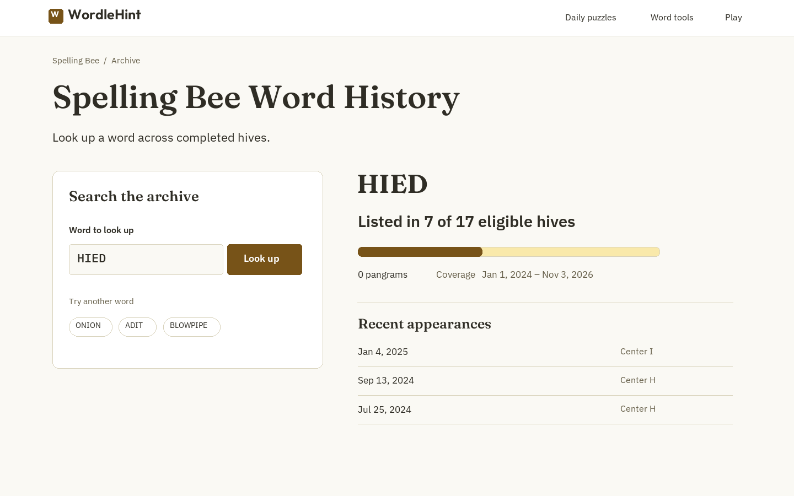
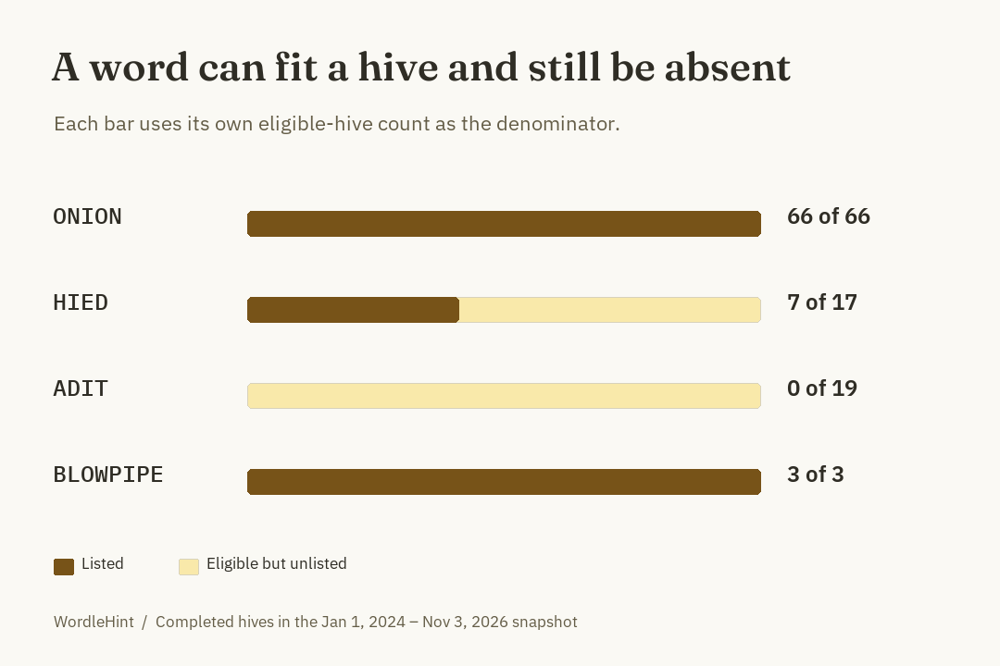

# Spelling Bee 单词历史查询页面需求

**建议 URL**　`/spelling-bee-word-history`　 **语言**　美式英语　 **调研日期**　2026-11-19

玩家记得某个词以前能得分，想知道它出现过几次、有没有做过 pangram，还想找到当时的题。本页从一个单词出发，在首屏回答“在符合字母条件的 Y 期中，实际有 X 期收录”，给出覆盖日期和可点开的历史记录。当天正在进行的蜂巢不进入查询。

[英文正文与可用表格](landing-copy.md) · [桌面首屏](visuals/desktop.png) · [移动首屏](visuals/mobile.png) · [正文数据配图](visuals/hive-comparison.png)

## 竞品和需求证据

面向美国英语用户检索 `spelling bee word history`、`spelling bee word checker archive`、`has this word ever been a pangram`。结果同时出现按词查询、历史词典和按日期归档。对本页而言，主意图是从一条具体拼写找到可核实的证据。以下观察来自公开页面，搜索量和固定排名没有用作优先依据。

| 来源 | 实际做法 | 落到本站的选择 |
|---|---|---|
| SBeeHub | 一行输入框查该词曾被哪些历史题收录，明确提示历史出现不能保证当天被接受。[历史查询](https://sbeehub.com/spelling-bee-word-checker/) | 保留输入即查的便利，结果增加“符合字母条件的总期数”，让零次有明确含义。 |
| LexiConnexxions | 区分曾收录后不再收录、后来开始收录和多次变动等情形，并按其档案持续记录变化。[历史分类](https://lexiconnexxions.com/lexicon/histories/) | 比较具体日期的题单。只描述档案里发生了什么，不把缺席原因归给编辑。 |
| NYT Bee | 单期页面按日期组织蜂巢和题目数据，适合手头已有日期的人。[按期归档示例](https://nytbee.com/Bee_20261017.html) | 从结果行链到站内当天档案，给只记得一个词的人一条相反方向的检索路径。 |
| 玩家讨论 | 玩家问能否输入单词查看出现次数，也有人想核实某词是否当过 pangram。[出现次数问题](https://www.reddit.com/r/NYTSpellingBee/comments/1r8dgw5/how_many_times_a_word_has_appeared/) · [pangram 问题](https://www.reddit.com/r/NYTSpellingBee/comments/1vlv8ur/curious_if_a_specific_word_has_ever_been_the/) | 首屏同时给收录次数、机会次数与 pangram 次数。日期明细可继续检查。 |

本站的增量是把查询框、机会分母、收录分子、缺席日期和本站逐日历史题放在同一处。该领域已有深入的历史词典，因此不宣称本站拥有独家的收录史。对外只承诺下方数据源覆盖的区间。

## 首屏工具和结果定义

### 初始态与查询流程

- 首次进入展示带标签的示例 HIED，让用户在输入前就看懂 7/17。输入框可替换，Enter 和 `Look up` 都能提交。ONION、ADIT、BLOWPIPE 三个示例各展示一种不同结果。首次预载不算用户查询完成。
- 结果按“标准化后的拼写、收录期数 / 机会期数、pangram 次数、档案覆盖日期、最近记录”排序。带日期的最近记录从新到旧，显示中心字母。可切换“Listed dates”和“Eligible omissions”，状态改变不清空查询。
- 去首尾空白、英文大小写等价。少于 4 字母、含内部空格或标点、超过 7 种不同字母，分别提示原因。清空输入可回到占位示例，历史零结果也保留输入值。
- 查询新词时一次切换到完整结果，避免旧词的日期配上新词的数字。查询没有记录、机会为零、历史数据暂不可用是三种状态，使用不同文案。比例分母为零时显示 “No eligible hives in this archive”，不显示百分比。

### 可复算的数据规格

每个**已结束**的蜂巢日期只计一次。一个词满足不少于四个字母、包含中心字母、其全部不同字母均在当天字母集合内，记为一次机会。词可重复使用字母；收录以当日 `answers` 中的精确拼写为准；pangram 次数从同一日期的 `pangrams` 读取。计数、明细、示例和客户端可读索引采用相同截止日，排除当期及预取的未来题。生成时记录实际覆盖首日、末日和天数。[Spelling Bee 历史文件](../../../../data/spelling-bee-daily.json) · [现有归档读取层](../../../../lib/spelling-bee-daily.ts)

| 快照验收词 | 机会 | 收录 | Pangram | 该例验证什么 |
|---|---:|---:|---:|---|
| ONION | 66 | 66 | 0 | 含重复字母，最近收录 2026-10-18 |
| HIED | 17 | 7 | 0 | 混合结果，有 10 个可单独核查的符合条件但未收录日期 |
| ADIT | 19 | 0 | 0 | 字母条件成立，题单没有该词，日期栏能列出这 19 期 |
| AARDVARK | 0 | 0 | 0 | 在本快照中没有机会，解释分母为零 |
| BLOWPIPE | 3 | 3 | 3 | 八个字符、七种不同字母，三期都记作 pangram |

样本覆盖 2024-01-01 至 2026-11-03 的 1,038 期。HIED 最近三条收录是 2025-01-04（中心 I）、2024-09-13（H）、2024-07-25（H）。日期详情必须指向本站真实存在的归档页面。同一组字母在不同日期可有不同题单；禁止按字母集合去重。

## Frontend Design 排版方案

### 首屏视觉和响应式

采用便于核对日期和分数的排版。让玩家先看到词和 “Listed in 7 of 17 eligible hives”，横向色带只用于辅助读数。余下版面用于真实日期记录。页面不需要蜂巢插画来说明一个以历史检索为主的操作。

| 项目 | 桌面 1440 × 900 | 手机 390 × 844 |
|---|---|---|
| 工具布局 | 左侧约 490px 是查词，右侧给结果、覆盖日期和最近三条记录 | 一列顺序是 H1、查词、示例、分数、截止日期、最近两条记录 |
| 核心信息位置 | 输入从 y≈440 开始，查询词和分数位于右侧同一视口 | 输入从 y≈257 开始，核心分数约 y=460，首条历史日期约 y=700 |
| 长文起点 | 介绍及 FAQ 放在核心功能区之后，基准视口首个正文 H2 为 y≥900 | 正文 H2 为 y≥844。页面高度按自然内容增长，不在工具上方留广告占位 |
| 适配 | 日期、中心字母和收录状态用固定列便于扫读 | 320px 时按钮可另起一行，日期表变为两行一条记录，保留文本标签 |

底色 `#FAF9F4`，正文 `#2F2D25`，次要文字 `#645D47`，按钮和收录条 `#775318`，机会底条 `#F9E9AA`。标题用仓库内 Fraunces，输入和说明用 IBM Plex Sans，待查词可用 IBM Plex Mono。桌面 H1 约 58px，手机 36px。正文 17–18px、行高 1.6、最大 68ch；日期表允许复制文本。

色带旁必须有可读分数，零值保留数字，不能只靠两种颜色区分记录。输入有持久标签、按钮有焦点样式。提交后读屏播报词和总数，不自动滚到长文。移动端的示例词热区至少 44×44px。全站页眉沿用现有组件。

### 正文数据配图

每条的宽度表示本词的全部机会，每行分母不同，图上同时写分数。发布时放在第二屏的示例表之后。英文 alt 为 “Listed and eligible hives: ONION 66 of 66, HIED 7 of 17, ADIT 0 of 19, and BLOWPIPE 3 of 3.” 图注写明样本区间；正文的原生表提供等价数据，小屏可点图放大。

## SEO Planner 内容方案

| 要素 | 定稿方向 |
|---|---|
| 主关键词与 SEO title | `spelling bee word history`；标题为 “Spelling Bee Word History: Look Up Any Past Word” |
| 搜索摘要 | “Look up a Spelling Bee word across completed hives. See when it was listed, how often its letters fit, and whether it appeared as a pangram.” |
| 相关查询 | `spelling bee word checker archive`、`has this word been a pangram`、`how many times has a word appeared in spelling bee` |
| 与已有页的边界 | 本页按一个词查过去。今日提示仍在 `/spelling-bee-hints-today`，逐期答案仍在 `/spelling-bee-answers`，随机练习仍在 `/spelling-bee-unlimited` |
| 索引和内链 | 本页自引用 canonical，站点地图只列工具入口。输入任意单词不生成可索引的海量词条。历史日期走真实日期页；历史答案、练习页可提供 “Look up a word’s history” 入口 |

### 从第二屏开始的阅读顺序

1. **Has this word ever appeared in a puzzle?** 读懂两个数字，先看 ONION 的 66/66，再看四行实例表。
2. **What counts as an eligible hive?** 逐步验证 2024-01-15 的中心 I 和外圈字母。H4 用改变中心字母的反例解释分母。
3. **Does a word always appear when it fits?** HIED、ADIT、AARDVARK 分别演示部分收录、有机会未收录、无机会；给出下一步动作。
4. **Was the word ever a pangram?** 用三条 BLOWPIPE 日期记录讲清词长和不同字母数。
5. **How do I use the date list?** 查中心字母、最近日期和变动；H4 解释档案中的首次和最近一次。
6. **Questions about looking up a word** 回答今天是否接受、词形变化、零结果和如何向朋友准确引用数据。

### 英文稿指标

正文文件有 1 个 H1、6 个 H2、11 个 H3、9 个 H4、3 张原生表。按可见英文内容计 **1,901 词，核心短语 20 次，密度 1.05%**。单独统计普通段落仍有 **1,565 词，16 次，1.02%**。最长段落 64 词。

关键词不区分大小写，用独立英文词元计数，连续完整短语一次计一次，密度为短语次数除以总词数。元数据、alt、导航和需求说明不计入本组数字。首页 H1 在工具上方渲染一次；正文文件中的 H1 用于标明交付稿标题。

## 发布验收

- 初次加载能读到一个明确标注的示例。手机首屏看得到查词、结果分数、覆盖范围及最近记录；结果为空时有可执行的下一步。
- 重新用固定快照验证五条基准词。换到更新的归档时使用实际截止日并重新计算实时结果，配图和例题仍标注原快照。
- 日期与期数一致，未收录日期与收录日期互斥，两者相加等于机会总数。当地换题前后的页面、公开索引和例词均只包含已结束的蜂巢。
- 衡量主动完成搜索、同一会话查询第二个不同词、从结果打开历史题。默认示例不计搜索成功；统计事件使用结果类型和数量，无须上报用户原始输入。
