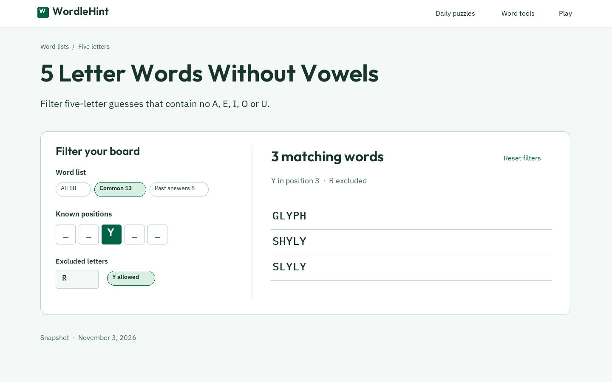
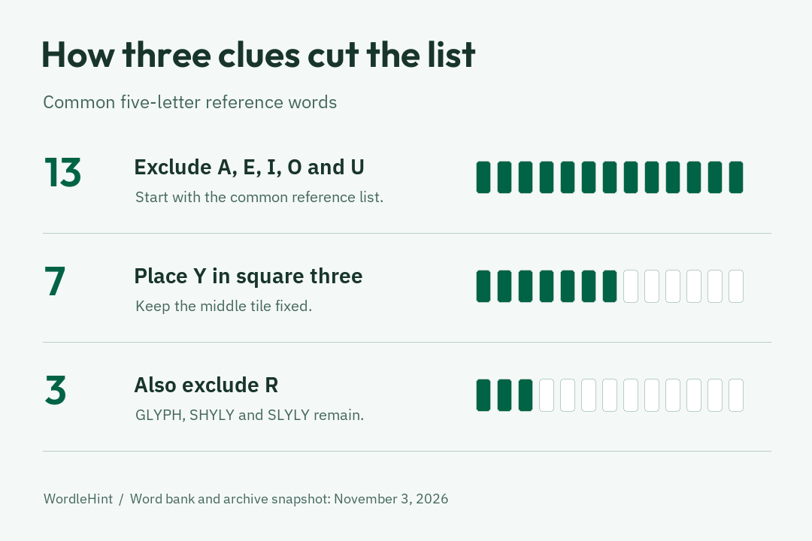

# 五字母无元音词表页面需求

**建议 URL**　`/5-letter-words/without-vowels`　 **语言**　美式英语　 **调研日期**　2026-11-19

玩家刚确认 A、E、I、O、U 全部排除，希望用剩下的绿格快速找出几个可以猜的词。验收的核心动作是在手机首屏内选择词池、固定第三格为 Y、排除 R，然后读到 GLYPH、SHYLY、SLYLY。下滑后再解释字母规则、历史和猜法。

[英文正文与可用表格](landing-copy.md) · [桌面首屏](visuals/desktop.png) · [移动首屏](visuals/mobile.png) · [正文数据配图](visuals/board-narrowing.png)

## 竞品和搜索意图

面向美国英语用户检索了 `5 letter words without vowels`、`five letter words no vowels except y` 及相关词型页面。公共英文搜索能看到答案清单、静态分类和交互词表。下表只比较实际读到的功能，不推算搜索量和排名。

| 来源 | 用户首先拿到什么 | 本页采用的决定 |
|---|---|---|
| WordFinder by YourDictionary | 有历史答案日期、词义和冷僻词分组。读者能理解个别词为什么在清单里。[原页](https://wordfinder.yourdictionary.com/blog/5-letter-words-without-vowels-every-valid-wordle-guess-and-past-answers/) | 给真实历史记录，并选少量词做拼写对照。词义、历史解释放在结果之后。 |
| FiveLetterWords.io | 页面有位置和排除条件，能把筛选带到词工具，还区分过往答案与模型估计。[原页](https://www.fiveletterwords.io/five-letter-words-with-no-vowels) | 首屏操作必须有即时结果。每个词池公开来源，避免把参考表标签解释成明日出现概率。 |
| WordleFinder | 标题直接说明 Y 可以使用，并展示 41 条“Best results”。其集合与本站全部词池口径不同。[原页](https://www.wordlefinder.org/without/vowels/) | 让玩家自己切换是否排除 Y，并在同一位置看到 58、13、8 三个词池的区别。 |
| 玩家讨论 | 玩家会直接问 “Is there any valid words without vowels?”；答案有效、可猜、做过答案这三种含义容易混在一起。[问题原帖](https://www.reddit.com/r/wordle/comments/1n7ujx0/is_there_any_valid_words_without_vowels/) | 零结果要说明是哪一个选定词池为零，并给恢复条件的动作。 |

本站的实质增量是可以手动走完的 **13 → 7 → 3** 例局和可复核的数据口径。竞品已经有完整词表、历史答案和基础筛选，本页的价值取决于玩家多快能从自己的线索找到少数可用词。

## 首屏功能和数据

### 默认状态与交互

- H1 下用一句英语说明排除 A/E/I/O/U、Y 默认可用。初次打开选 `All`，显示总数和至少三个候选，优先排序常见参考词。面板旁提供 `Try a board`，点击后载入设计图中的例局，明确显示已载入示例。设计图展示的是完成筛选后的状态。
- 三个词池用单选控件。标签上的 58、13、8 表示快照中各池基准数，结果区另报当前匹配数。输入已知位置和全局排除字母后立即重算，切换词池保留这些条件。重置回到初始状态。
- 五个格子只录确定位置。输入统一大写、可粘贴五格模板，键盘可逐格移动。全局排除区去重。灰色重复字母若另有同字母的黄/绿反馈，提示转用完整 Solver，不把它当作全局排除。
- 固定 Y 与“排除 Y”冲突时，明确指出两个条件，给出清除排除项的按钮。没有匹配时保留输入，让用户尝试更宽词池。桌面和移动端采用同一状态规则。

### 词表口径与测试夹具

日期统一使用数据记录的 puzzle date。以下为 2026-11-03 有界快照。线上总数和历史日期由当次允许公开的数据计算。历史视图默认排除当前仍在玩的题；示例快照是一份已经结束的历史样本。

| 条件 | 猜词表 | 常见参考表 | 历史答案去重 |
|---|---:|---:|---:|
| 排除 A/E/I/O/U，允许 Y | 58 | 13 | 8 |
| 再排除 Y | 6 | 0 | 0 |
| 常见参考表 → 第三位 Y | — | 7 | — |
| 再排除 R | — | 3 | — |

三个集合独立取交集，禁止把它们按“58 包含 13 再包含 8”处理。PSYCH 出现在历史与猜词表，但不在这套 2,315 词的常见参考表。读取完整历史，早于独立日期页起始日的条目仍展示日期，只有存在的日期页才生成链接。以本站 JSON 为准复算历史日期。[五字母词库](../../../../data/word-bank/5.json) · [Wordle 全历史](../../../../data/wordle-daily.json) · [日期页范围](../../../../data/date-pages.json)

## Frontend Design 排版方案

### 手机和桌面首屏

| 项目 | 桌面 1440 × 900 | 手机 390 × 844 |
|---|---|---|
| 视觉中心 | 五格输入与结果并排，左侧录入、右侧保留足够空间读完整单词 | 单列顺序是 H1、词池、位置、排除条件、结果；三项示例结果可在首屏读完 |
| 基准坐标 | 工具约从 y=310 开始，首个结果约 y=500 | 工具约从 y=240 开始，首个结果约 y=610 |
| SEO 正文边界 | 第一段长文从下一屏开始，首个 H2 的顶部在基准视口 y≥900 | 正文 y≥844。首屏空间给候选列表、口径和控件，不靠展示大图留白 |
| 更小屏幕 | 仅工具内使用双栏 | 320–375px 允许按钮换行，优先保留输入和首个结果。小高度或放大字体时保持文档流，可正常下滚 |

底色 `#F4F8F7`，正文 `#18352C`，次要文字 `#43675C`，可交互强调色 `#006345`，选中底色 `#DAEFE4`。标题用站内 Outfit，说明用 IBM Plex Sans，单词格用 IBM Plex Mono。桌面 H1 约 56px，手机 34px；正文 17–18px、1.6 行高、最大 68ch。结果用可选中的文本。窄屏优先精简列，不靠缩小字重或字号塞下表格。

全站导航沿用现有组件，效果图聚焦工具。按钮可见区域可紧凑，但触控热区至少 44×44px。绿色确定格另有字母位置标签，筛选选项有选中语义与可见焦点。结果计数可由读屏在输入停顿后播报；普通改值不抢焦点。

### 第二屏数据配图

放在中位 Y 的例局与对应数据表旁。每行使用同样的 13 格刻度，数字、条件、格数同时编码。移动端使用可读的 HTML 数据表作等价内容；小图可点击查看原尺寸。下图是为讲解固定历史示例设计的独立配图，并非操作控件。

英文 alt 建议为 “Thirteen common entries narrow to seven with Y in the middle and three after R is excluded.” 英文图注为 “The same reference list is used at every step.” 发布时保留图的固定高宽比，图旁表格提供相同数字。

## SEO Planner 内容方案

| 要素 | 定稿方向 |
|---|---|
| 主关键词与 SEO title | `5 letter words without vowels`；标题为 “5 Letter Words Without Vowels for Wordle” |
| 搜索摘要 | “Filter five-letter words with no A, E, I, O or U. Place known letters, allow or exclude Y, and compare common guesses with documented past answers.” |
| 相关查询 | `5 letter words with no vowels except y`、`5 letter words without vowels or y`、`vowelless Wordle answers`；这些需求都由同一个页面承接 |
| URL 与索引 | 单一自引用 canonical。筛选为页面内状态。可抓取内容包括默认结果、数据口径、例局和历史表。筛选组合不单独提交 sitemap |
| 内链 | 从五字母词表首页及四字母无元音页链接本页。正文中的 “Wordle Solver” 和 “answer archive” 分别指向 `/wordle-solver`、`/wordle-answers` |

### 从第二屏开始的阅读顺序

1. **Which words are worth trying first?** 通过三行表解释词池，H3 比较总数，H4 说明不同选词场景。
2. **How does Y change the list?** 以 Y 允许和 Y 排除划分 H3，解释为什么宽词池仍有 6 个结果。
3. **Work through a board with a green Y** 用表和原创配图展示 13 → 7 → 3，H4 解释最后三个词如何区分。
4. **Which words have appeared in real puzzles?** 用四行实例表和完整八词清单回答历史问题。
5. **Use the shape of a word to test a clue** 用 PH、ST、重复 Y 的练习回答拼写和猜词意图。
6. **Questions that come up during a game** 用 H3/H4 回答何时该用此表、是否需要排除 Y、为何不同词库数字不同。

### 英文稿指标

正文文件有 1 个 H1、6 个 H2、11 个 H3、9 个 H4、3 张原生表。按可见英文内容计 **2,050 词，核心短语 22 次，密度 1.07%**。排除所有标题、表格和数字列，仅算普通段落仍有 **1,715 词，18 次，1.05%**。最长段落 62 词。

关键词不区分大小写，独立词元计数，连续完整短语一次计一次，密度为短语次数除以总词数。标题与正文稿一起交付，开发只渲染一个 H1。元数据、图片 alt、站点导航和需求说明都不计入这组数字；最终按发布稿复核。

## 发布验收

- 首屏可操作，初始词表与结果数无需先展开正文；示例模式输出三个指定词。缩到 320px、字体放大和仅键盘操作时仍可完成筛选。
- 冲突条件、零结果、切换词池、清空条件均有确定反馈。历史日期记录和推荐词池来源经重新核算，当天及未来题不会经历史列表被揭晓。
- 上线后按美国英文自然搜索入口查看相关查询，并记录首个有效筛选和例局完成率。一次会话反复改同一格时，首次完成事件只记一次。
